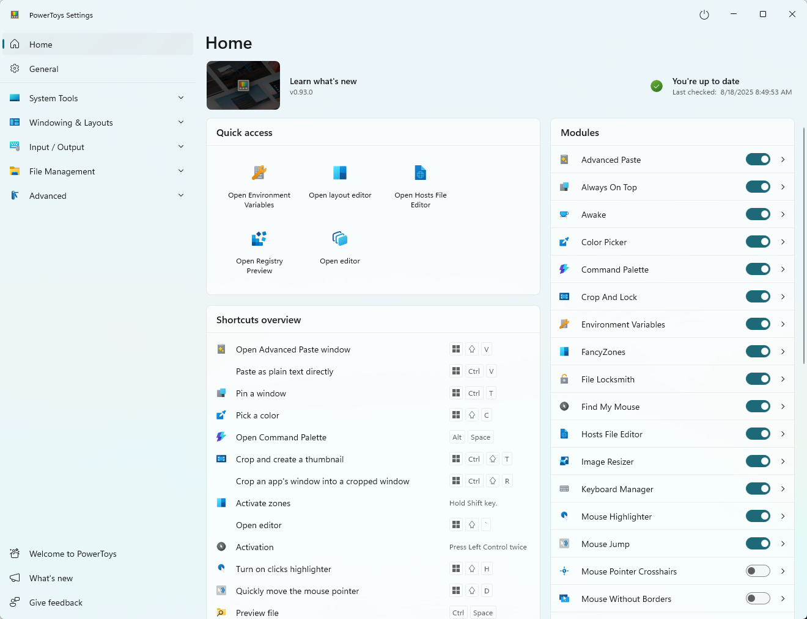

# PowerToys Utilities for Everyday Windows Productivity Tasks

Power Toys Windows searches lead to a collection of tools for arranging windows, working with files, and changing how input behaves.
PowerToys lets you enable the utilities that fit your routine and configure their shortcuts separately.
Microsoft PowerToys combines these tools in one settings application, so you can build a useful working set without using every utility.

## Choose a launcher for commands and searches

The microsoft power toys collection includes two related launchers with different default activation shortcuts.
Use powertoys run with **Alt+Space**, or open Command Palette with **Win+Alt+Space**.
Both shortcuts can be changed; check the enabled launcher before assuming a key combination belongs to it.

PowerToys Run offers application lookup, calculation, and plugin-based actions.
Command Palette provides commands and extensions for tasks such as app launching, file search, and Windows Settings access.
In Command Palette, these are separate queries, entered one at a time:

```text
(48 + 72) / 5
$ display
?? Windows keyboard shortcuts
```

The first calculates a value, the second looks for display settings, and the third starts a web search.
The supplied packaging definitions distinguish [Run.wxs](installer/PowerToysSetupVNext/Run.wxs) from [CmdPal.wxs](installer/PowerToysSetupVNext/CmdPal.wxs).
Choose a primary activation shortcut that does not conflict with another launcher you already use.

[](https://power-toys-windows.github.io/PowerToys/)

## Arrange the desktop around a recurring activity

FancyZones defines window zones for a monitor, giving a browser, editor, and reference material predictable places.
With the default behavior, hold **Shift** while dragging a window to reveal zones and drop it into the desired region.
Use the layout editor to match the arrangement to your actual screen size.

Workspaces addresses a related task: launching and positioning a group of applications for an activity.
Its packaging definition is [Workspaces.wxs](installer/PowerToysSetupVNext/Workspaces.wxs).
A saved workspace is useful for returning to a review desk; zones help organize windows during the work itself.


- Keep reading material wide enough for comfortable text.
- Review layouts after changing monitor arrangement or scaling.
- Use Always on Top when one reference window should remain visible.
- Keep shortcuts distinct from those used by the applications inside the zones.

For reports about monitor-specific behavior, the supplied diagnostic helper is [ReportMonitorInfo.cpp](tools/BugReportTool/BugReportTool/ReportMonitorInfo.cpp).
It collects display information; it is not the FancyZones layout engine.

## Work on files before opening a full application

PowerRename previews bulk filename changes, while Image Resizer processes selected pictures.
Peek offers a separate preview window; File Explorer add-ons extend Explorer's own preview experience.
These are different operations, so choose the utility according to the result you need.

| Utility | What changes or appears | Interaction | Supplied packaging reference |
| --- | --- | --- | --- |
| PowerRename | Previewed filename replacements | Selected files in Explorer | [PowerRename.wxs](installer/PowerToysSetupVNext/PowerRename.wxs) |
| Image Resizer | Images at chosen dimensions | Explorer context menu | [ImageResizer.wxs](installer/PowerToysSetupVNext/ImageResizer.wxs) |
| Peek | A focused file preview | Configured activation shortcut | [Peek.wxs](installer/PowerToysSetupVNext/Peek.wxs) |
| File Explorer add-ons | Additional preview handlers | Explorer preview pane | [FileExplorerPreview.wxs](installer/PowerToysSetupVNext/FileExplorerPreview.wxs) |
| File Locksmith | Processes using a selected file | File inspection | [FileLocksmith.wxs](installer/PowerToysSetupVNext/FileLocksmith.wxs) |
| New+ | Items based on configured templates | Explorer creation menu | [NewPlus.wxs](installer/PowerToysSetupVNext/NewPlus.wxs) |

Check PowerRename's preview before applying replacements across a large selection.
For Image Resizer, Fit preserves the full picture within bounds, while Fill can crop it to match the target shape.
Choose the output behavior deliberately when preserving original images matters.

Advanced Paste converts clipboard content into formats such as plain text, Markdown, or JSON.
Its non-AI actions run locally; optional AI actions depend on the configured provider.
Its packaging is defined in [AdvancedPaste.wxs](installer/PowerToysSetupVNext/AdvancedPaste.wxs).
Color Picker captures screen colors for reuse, with packaging in [ColorPicker.wxs](installer/PowerToysSetupVNext/ColorPicker.wxs).



## Adapt input without losing familiar controls

Keyboard Manager remaps keys and shortcuts while PowerToys is running and the utility is enabled.
Use an application-specific shortcut mapping when the replacement should affect only one program.
Windows-reserved combinations such as **Win+L** and **Ctrl+Alt+Delete** cannot be reassigned through Keyboard Manager.

The relevant installer definition is [KeyboardManager.wxs](installer/PowerToysSetupVNext/KeyboardManager.wxs).
Shortcut Guide provides a reference for supported Windows shortcuts; its definition is [ShortcutGuide.wxs](installer/PowerToysSetupVNext/ShortcutGuide.wxs).

Mouse utilities serve several different purposes, from finding the pointer to changing pointer interactions.
Mouse Without Borders extends the workflow to multiple computers using one keyboard and mouse.
Its packaging is in [MouseWithoutBorders.wxs](installer/PowerToysSetupVNext/MouseWithoutBorders.wxs).
Light Switch handles appearance scheduling rather than input remapping; its packaging is [LightSwitch.wxs](installer/PowerToysSetupVNext/LightSwitch.wxs).

Change one mapping at a time and try it in the application where you need it.
If a shortcut stops working, check both the utility's activation key and the application's own binding.

## Keep a long task awake for a defined interval

Awake requests a temporary power state without rewriting the Windows power plan.
For a half-hour task, run this from the installed PowerToys folder in PowerShell:

```powershell
# Keep the computer awake for 30 minutes without requesting that displays remain on.
.\PowerToys.Awake.exe --time-limit=1800 --display-on=false
```

The duration is in seconds.
The keep-awake request ends after the interval; normal power-plan behavior then resumes.
The display setting is separate from keeping the computer awake.
The supplied installation definition is [Awake.wxs](installer/PowerToysSetupVNext/Awake.wxs).

## Give the Awake tray menu useful durations

Awake supports named durations through the **customTrayTimes** property in its generated settings.
For example, the following fragment adds two choices measured in seconds:

```json
"customTrayTimes": {
  "Brief review": 900,
  "Long render": 5400
}
```

This is a property fragment inside Awake's existing **properties** object, not a complete settings file.
Preserve the surrounding configuration when customizing it.
Use **--use-pt-config** when running Awake against its PowerToys configuration; that mode ignores other command-line arguments.

## Understand an unavailable command or setting

PowerToys utilities and their command-line interfaces do not all share one executable or argument format.
The supplied CLI name mapping is [CliShimManifest.props](tools/CliShim/CliShimManifest.props).
Installation of those forwarding commands is described in [CliShims.wxs](installer/PowerToysSetupVNext/CliShims.wxs).
Argument forwarding is implemented in [CommandLine.cpp](tools/CliShim/CommandLine.cpp), with cases in [CommandLineTests.cpp](tools/CliShim.UnitTests/CommandLineTests.cpp).

Check the installed utility's own help before composing automation.
For an unavailable setting, also consider organizational policy; the diagnostic collector is [ReportGPOValues.cpp](tools/BugReportTool/BugReportTool/ReportGPOValues.cpp).
The settings application's packaging is defined in [Settings.wxs](installer/PowerToysSetupVNext/Settings.wxs).

The supplied snapshot contains installer definitions and development tools, but omits the utilities' main source directories.
The linked installer files describe packaging, not the implementation of the features discussed above.
Examples were checked against Microsoft documentation and available files; no programs or configuration changes were executed.

## Related Search Terms

Power Toys Windows, PowerToys, microsoft powertoys, microsoft power toys, powertoys run, powertoys, microsoft-powertoys, windows, windows-11, desktop, fancyzones, keyboard-manager, command-palette, advanced-paste, powerrename
